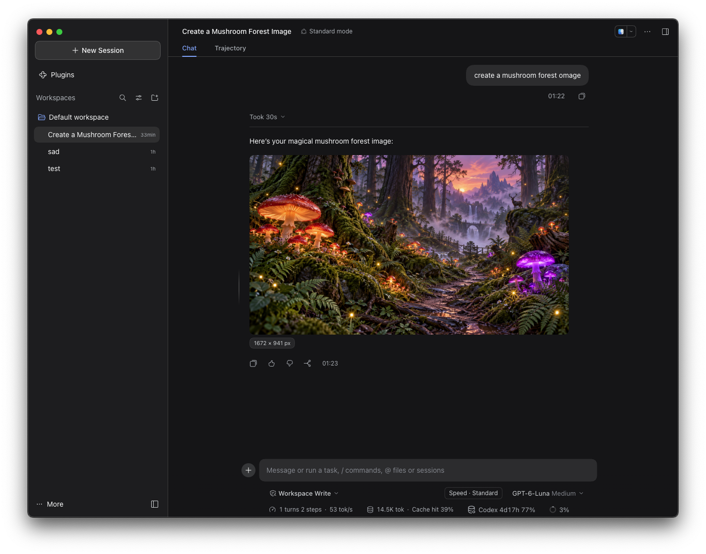

# DeepSeek Harness

English | [中文](README.zh.md)

DeepSeek Harness (`dsh`) is an open-source agent harness developed by [DeepSeek AI](https://deepseek.com).

It is built on an **everything-is-a-plugin** architecture and powered by [Cordis](https://github.com/cordiverse/cordis), whose design is described in [_A Programming Paradigm for Spatiotemporal Composability_](https://arxiv.org/abs/2608.25512).

Documentation: [https://deepseek-harness.github.io/deepseek-harness/](https://deepseek-harness.github.io/deepseek-harness/)

## Harness with TensorFold Bar on a Mac (this fork)

This fork ships a desktop app named **Harness** that runs coding agents on a model served on your own Mac by [TensorFold](https://github.com/ashhart/TensorFold), controlled from the [TensorFold Bar](https://github.com/larssteenhoff/TensorFoldBar) menu bar app. On an Apple Silicon Mac, install both prebuilt apps with one command in Terminal; nothing else needs to be installed first:

```sh
curl -fsSL https://github.com/larssteenhoff/deepseek-harness/releases/latest/download/install-mac.sh | bash
```

The script downloads the [latest release](https://github.com/larssteenhoff/deepseek-harness/releases/latest), installs `~/Applications/Harness.app` and `~/Applications/TensorFold Bar.app`, and sets up the Harness desktop profile:

- the local TensorFold server (`http://127.0.0.1:8080/v1`, model `local-model`) as the default model,
- [`tensorfold-launcher`](tensorfold-launcher/client.js): a TensorFold button above Settings in the sidebar that opens TensorFold Bar, or its GitHub page when it is not installed,
- [`harness-colors`](harness-colors/client.js): a solid `#202020` sidebar and `#181818` main area in the dark theme,
- [`remove-logo`](remove-logo/client.js): hides the sidebar brand mark and name.

Run the same command again to update both apps; your settings stay. Pick a model and context window from TensorFold Bar's menu: the first start of a model downloads its weights (about 1.6 GB for the default Qwen3.5 2B, over 100 GB for the largest), and TensorFold Bar keeps Harness's model entry in step with the model it serves.

Both apps are ad hoc signed, not notarized by Apple. The installer clears the download quarantine so macOS opens them; if you download the release files in a browser instead, macOS refuses to open them until you allow them under System Settings › Privacy & Security.

To build Harness from source instead (needs [Node.js](https://nodejs.org/en/download) 24.9 or newer), run the script from a checkout; it then links the plugins from the checkout, so keep it in place:

```sh
git clone https://github.com/larssteenhoff/deepseek-harness.git ~/deepseek-harness
~/deepseek-harness/install-mac.sh
```

Options: `--prebuilt`, `--build-tensorfold-bar`, `--skip-harness`, `--skip-tensorfold-bar`, `--no-launch`; see `./install-mac.sh --help`.

## Developer preview

DeepSeek Harness is in _developer preview_ and iterating rapidly. **THERE WILL BE COMPATIBILITY-BREAKING CHANGES.**

Review the [safety notice](SAFETY.md) before running the project.

## Screenshot

<p align="center"></p>

## Run

### Run from `npm`

Install `Node.js`, then run:

```sh
npx @deepseek-ai/dsh web
```

The command starts the Web UI at `http://127.0.0.1:3080` by default and opens it in the default browser for a local launch. An SSH launch only prints the host URL because the SSH client or editor owns the local forwarded address. Pass `--no-open` to run the server without opening a browser. See [Web UI guide](docs/user/guide/index.md).

### Run from source

To run from a repository checkout:

```sh
git clone https://github.com/deepseek-ai/deepseek-harness.git
cd deepseek-harness
pnpm install
pnpm run build
pnpm dsh web
```

`pnpm run build` prepares the repository artifacts. `pnpm dsh web` uses those built artifacts without rebuilding.

## Community and support

- Submit feedback or bug reports through [GitHub Discussions](https://github.com/deepseek-ai/deepseek-harness/discussions).
- Add the [`dsh-plugin`](https://github.com/topics/dsh-plugin) topic to your plugin repository for discoverability.
- Join <a href="https://discord.gg/4MrtZUhpxg">DeepSeek Harness Discord community</a>.

## Contributing

See [CONTRIBUTING.md](CONTRIBUTING.md).

## Development

Start with the [development guide](docs/development.md) and [architecture documentation](docs/architecture.md).

`pnpm run dev:web` builds, serves, and rebuilds client bundles on source edits in one terminal, and `make help` lists the matching Make targets for Web and Desktop; the guide's application commands section owns the full table.

For agents, follow [AGENTS.md](AGENTS.md).

## Citation

```bibtex
@misc{deepseek-harness2026,
  title={DeepSeek Harness: Everything is a Plugin},
  author={DeepSeek-AI},
  year={2026},
  publisher={GitHub},
  howpublished={\url{https://github.com/deepseek-ai/deepseek-harness}},
}
```

## License

[MIT](LICENSE)

Third-party dependencies and their licenses are disclosed in [THIRD_PARTY_NOTICES.md](THIRD_PARTY_NOTICES.md).
